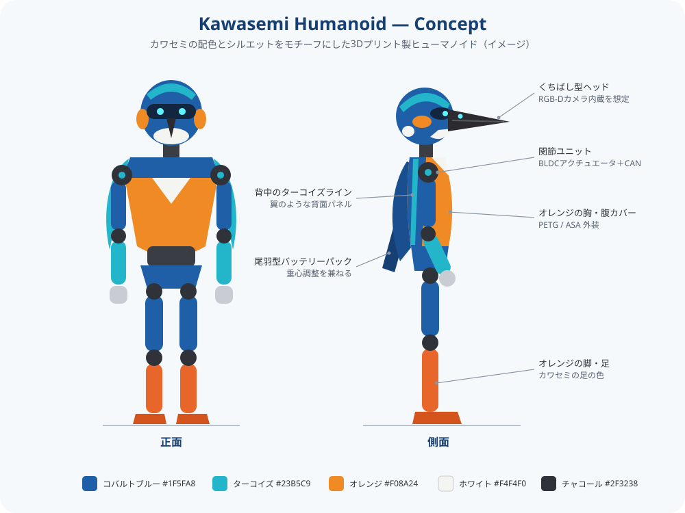

  

# Kawasemi Humanoid

Berkeley Humanoid Liteを技術的な参考にした、3Dプリント製のオリジナルヒューマノイドと、VLA研究の開発計画です。

**完成目標：2028年1月**

## デザインコンセプト：カワセミ

名前のとおり、カワセミ（翡翠）の姿と色をモチーフにします。

| 部位 | カワセミのモチーフ | ロボットでの役割 |
|---|---|---|
| 頭部 | 長いくちばし | くちばし型ヘッド。RGB-Dカメラを内蔵する想定 |
| 背中 | 光るターコイズの背中の線 | 背面パネルと翼型フィン。配線を隠すカバーも兼ねる |
| 胸・腹 | オレンジの腹 | PETG / ASA製の外装カバー |
| 喉 | 白い喉 | 胸元のアクセントパーツ |
| 尾 | 短い尾羽 | 尾羽型バッテリーパック。重心の調整も兼ねる |
| 脚 | 赤みのあるオレンジの足 | 脛と足の外装 |

配色はコバルトブルー（#1F5FA8）、ターコイズ（#23B5C9）、オレンジ（#F08A24）、ホワイト、チャコール（関節部）の5色です。外装はフィラメントの色で塗り分け、塗装をしなくても仕上がるようにします。

## ロゴについて

ロゴは、このロボットを2頭身のキャラクターにしたものです。研究用のロボットでも親しみを持ってもらえるように、かわいい系にしました。

| 要素 | 意味 |
|---|---|
| 丸い頭と小さな体 | 2頭身のキャラクター体型。ヒューマノイドであることを残しつつ、親しみやすくする |
| コバルトブルーの頭とターコイズの頭頂部 | カワセミの頭と背中の色 |
| 短いくちばし | カワセミの長いくちばしを短く丸くした形。実機ではカメラを入れるくちばし型ヘッドにあたる |
| オレンジの頬と白い喉 | カワセミの顔の模様 |
| 暗いバイザーと光る目 | ロボットの顔。カメラで世界を見ることを表す |
| ターコイズの翼で手を振るポーズ | 腕を翼に見立てた形。人と関わるロボットを目指す姿勢を表す |
| 胸の関節マーク | 自作の関節アクチュエータを表す |
| アンテナ | ROS 2やネットワークでつながる、通信するロボットであること |
| 円の背景とターコイズの縁 | カワセミが暮らす水辺のイメージ |

ロゴのファイルは `docs/images/logo.svg`（元データ）と `docs/images/logo.png`（512×512、背景透明）です。

## ドキュメント

| ファイル | 内容 |
|---|---|
| [docs/design.md](docs/design.md) | 全体設計・研究計画（アクチュエータ、ROS 2、VLA、二足歩行、世界モデル） |
| [docs/3d-printer-selection.md](docs/3d-printer-selection.md) | 3Dプリンタ選定ガイド（判断基準、候補機の比較、増設の判断方法） |
| [docs/schedule.md](docs/schedule.md) | 2028年1月完成に向けた開発スケジュールとマイルストーン |

## 開発の順番

片腕 → 両腕・上半身 → VLA → 下半身 → 二足歩行 → 全身協調VLA

## 参考

- Berkeley Humanoid Lite: https://github.com/HybridRobotics/berkeley-humanoid-lite
- Berkeley Humanoid Lite Arm: https://github.com/berkeley-humanoids/berkeley-humanoid-lite-arm
- lite_description (V2): https://github.com/berkeley-humanoids/lite_description
