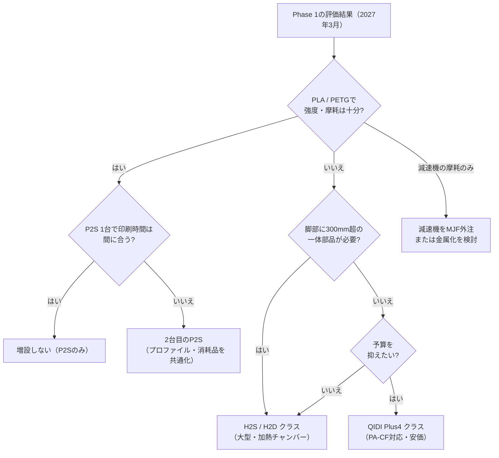

# 3Dプリンタ選定ガイド

**対象プロジェクト：Kawasemi Humanoid**
**作成日：2026年11月24日**
**完成目標：2028年1月**

---

# 1. 結論（推奨構成）

| 区分 | 推奨 | 理由 |
|---|---|---|
| 主力機 | **Bambu Lab P2S（保有機）をそのまま使う** | Berkeley Humanoid Lite（BHL）の部品はPLA前提で、約200mm角以内に収まるよう設計されている。P2S（256mm角）で全部品を造形できる |
| 増設機（判断は2027年4月） | **加熱チャンバー付き機を1台追加**（例：Bambu Lab H2S / H2D、QIDI Plus4 など） | 脚部・胴体の高負荷部品にPA-CF / PET-CFを使う場合と、印刷時間が足りない場合に限る |
| 外注 | **MJF（PA12）・CNC・板金を一部に使う** | 摩耗・剛性が問題になる部品は、FDMで粘るより外注のほうがスケジュール上安全 |

**新しいプリンタを先に買わない。** P2Sで単関節アクチュエータを試作し、計測データ（印刷時間・失敗率・摩耗・寸法誤差）をもとに増設するかを決める。

---

# 2. 判断基準

ヒューマノイド部品のプリンタ選定では、次の6項目を優先順に評価する。

| 優先度 | 評価項目 | ヒューマノイドで重要な理由 | 合格ライン（暫定） |
|---|---|---|---|
| 1 | 寸法精度・再現性 | ベアリング嵌合、サイクロイド減速機のバックラッシュに直結 | 嵌合穴の誤差 ±0.05mm以内（補正後）、同一部品10個のばらつきが小さい |
| 2 | 対応材料 | 関節ブラケット・脚部は荷重・熱・クリープに耐える必要がある | PLA / PETG / ASA / TPU が安定。PA-CF / PET-CFは高負荷部品に使う場合のみ必須 |
| 3 | 造形範囲 | 大腿・下腿・胴体フレームを分割しすぎると剛性が落ち、組立誤差が増える | 最低256mm角。300mm超なら脚部の分割数を減らせる |
| 4 | 稼働率・スループット | 全身分の部品を何度も試作し直す | 無人の夜間印刷で失敗率5%以下 |
| 5 | 運用コスト・保守 | ノズル摩耗、消耗品、修理期間 | 交換部品を国内ですぐ入手できる |
| 6 | 安全・環境 | ABS / ASA / PA系はVOC・粒子が出る | 換気・排気、フィルタ。研究室の規則に合う |

## 2.1 材料と必要なプリンタ機能

| 材料 | 使用部位（案） | 必要なプリンタ機能 |
|---|---|---|
| PLA | 減速機（BHL公式設計）、試作ブラケット、センサマウント | 標準機で可 |
| PETG | 配線カバー、ハウジング、外装 | 標準機で可 |
| ASA / ABS | 胴体フレーム、モータ近くの部品（耐熱） | 密閉筐体。反り対策にはチャンバー保温があるとよい。排気が必要 |
| TPU | 足裏、緩衝材、手指パッド | ダイレクトドライブ。AMSは使わず外部スプールから給紙 |
| PET-CF / PA-CF | 脚部ブラケット、大腿・下腿リンク（高剛性） | 硬化鋼ノズル、フィラメント乾燥。PA系は**加熱チャンバー**があると層間強度・反りが改善する |
| PC / PPS-CF | 今回は原則使わない | 高温ノズル・高温チャンバーが必要。費用対効果が低い |

> BHL公式は「標準PLAで印刷する設計」で、印刷パラメータはBambu Lab X1C向けに調整されている。材料を変えると収縮率や公差が変わるため、**材料変更は必ず寸法の再検証とセットで行う**。

---

# 3. 候補機の比較

数値は2026年11月時点で確認できた情報をもとにした目安。第三者サイトの間で値が食い違うものもあるため、**購入前に必ずメーカー公式の仕様と国内価格を確認する**（「要確認」は公式ページで裏付けが取れていない項目）。

| 機種 | 造形範囲（mm） | チャンバー | 得意な材料 | 位置付け |
|---|---|---|---|---|
| Bambu Lab P2S（保有） | 256×256×256 | 密閉・能動加熱なし（要確認） | PLA / PETG / TPU / ABS / ASA、CF系は硬化ノズルで可 | **主力機**。BHL部品は全て造形できる |
| Bambu Lab H2S | 約340×320×340（要確認） | 能動加熱（最大約65℃、要確認） | PA-CF / PC まで | 大型部品とPA系を1台で両方こなしたい場合の第一候補 |
| Bambu Lab H2D | 約325〜350×320×325（要確認） | 能動加熱 最大約65℃ | PA-CF / PC、2ノズルでサポート材を分けられる | 可溶性サポートや2材料印刷が必要な場合。高価 |
| QIDI Plus4 | 305×305×280 | 能動加熱 65℃ | PA-CF / PPS-CF（ノズル370℃） | エンジニアリング材料をいちばん安く始められる |
| Prusa Core One | 250×220×270（要確認） | 密閉・能動加熱なし | PLA / PETG / ASA | オープンで修理しやすいが、P2Sとの差は小さい |
| 外注 MJF（PA12） | 業者次第 | — | PA12（等方性に近い） | 摩耗・強度が重要な少数部品。FDMの積層方向の弱点がない |

## 3.1 増設機の選び方



**2台目もBambu Lab製にする利点：** Bambu Studioのプロファイル、3MF、AMS、消耗品を共通化でき、BHL公式の3MF（X1C向け）も流用しやすい。運用の手間が少ないことは、2028年1月の期限に対して大きな利点になる。

---

# 4. P2Sの検証計画（Phase 0〜1）

増設するかを判断するためのデータを、P2Sで取得する。

| # | 試験 | 方法 | 記録項目 |
|---|---|---|---|
| 1 | 寸法キャリブレーション | 穴・軸のテストピース（φ8〜φ30、0.05mm刻み） | 実測値、最適な穴補正量 |
| 2 | ベアリング嵌合 | 使用ベアリングの嵌合部だけを印刷 | 圧入／すきま嵌めの可否 |
| 3 | サイクロイドディスク | BHL公式3MFを（X1C向け設定の）そのまま印刷と、P2S向けに調整した印刷で比較 | バックラッシュ、回転トルクのむら |
| 4 | 積層方向の強度 | 同じブラケットを3方向で印刷し、曲げ試験 | 破断荷重、破断位置 |
| 5 | 材料比較 | PLA / PETG / ASA / PET-CF で同じ部品を印刷 | 剛性、クリープ、発熱時の変形 |
| 6 | 長時間運転 | 関節ユニットを数十時間回す | 摩耗量、温度、ネジの緩み |
| 7 | スループット | 片腕1本分の全部品を印刷 | 総印刷時間、失敗率、フィラメント使用量 |

試験7の結果から全身分の印刷時間を見積もる。

```
全身印刷時間 ≒ 片腕の印刷時間 × 部品比（全身／片腕） × 再試作回数（目安 3回）
```

これが **P2Sの稼働可能時間（例：1日16時間 × 稼働日数）を超える場合は増設する**。

---

# 5. 判断スケジュール

| 時期 | 判断 | 判断材料 |
|---|---|---|
| 2026年12月 | P2Sの材料・ノズル構成を確定（硬化鋼ノズル・乾燥機を用意） | 本書 |
| 2027年3月 | **増設するかの一次判断** | 試験1〜7の結果 |
| 2027年4月 | 増設機を発注（必要な場合のみ） | 一次判断、予算 |
| 2027年7月 | 脚部の材料を確定（PLA / PET-CF / PA-CF / 外注） | 上半身での強度・摩耗データ |

2027年5月以降は脚部の設計・印刷が集中するため、**増設機は遅くとも2027年5月までに稼働させる**。

---

# 6. 運用ルール

- 部品ごとに「材料・ノズル・積層方向・印刷プロファイル名・プリンタ名」をBOMに記録する
- 3MF（プロファイル込み）をGitで管理し、STLだけで管理しない
- フィラメントは使用前に乾燥する（特にPETG・TPU・PA系）
- CF入り材料は硬化鋼ノズルを使い、真鍮ノズルと混用しない
- ABS / ASA / PA系の印刷時は換気・排気を行う
- 長時間の無人印刷はカメラで監視し、異常時に停止する設定を有効にする

---

# 参考

- Berkeley Humanoid Lite 3D Printing Instructions: https://berkeley-humanoid-lite.gitbook.io/docs/getting-started-with-hardware/3d-printing-instructions
- Berkeley Humanoid Lite 論文: https://arxiv.org/abs/2504.17249
- BHL 印刷データ（MakerWorld）: https://makerworld.com/en/models/1327260-berkeley-humanoid-lite
- Bambu Lab P2S FAQ: https://wiki.bambulab.com/en/p2s/manual/p2s-faq
- 加熱チャンバー機の比較記事（第三者・参考程度）: https://makers101.com/best-3d-printer-for-nylon-carbon-fiber/
