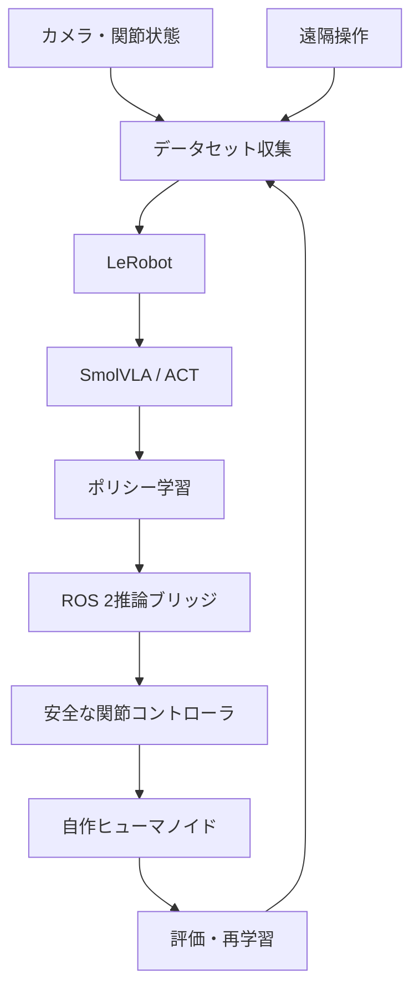
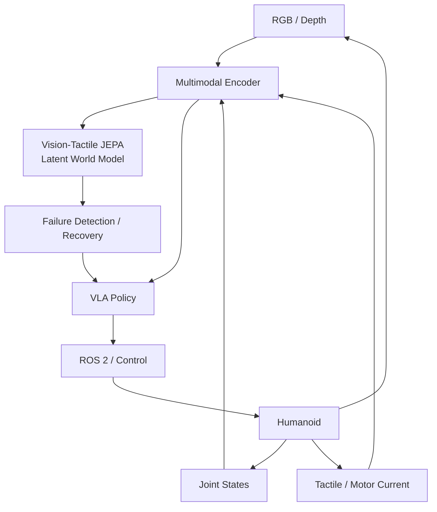

# Original Humanoid Robot Project
## Berkeley Humanoid Liteを参考にした3Dプリント製ヒューマノイドとVLA研究開発計画

**プロジェクト名（仮）：Kawasemi Humanoid**

**作成日：2026年11月24日**

**完成目標：2028年1月**（詳細は[開発スケジュール](schedule.md)）

**参考プロジェクト：Berkeley Humanoid Lite**

**使用3Dプリンタ：Bambu Lab P2S**（増設・材料の判断は[3Dプリンタ選定ガイド](3d-printer-selection.md)）

**研究キーワード：Humanoid Robotics / Embodied AI / VLA / Vision-Tactile World Models / Reinforcement Learning / ROS 2 / Agentic Robotics**

---

# 1. プロジェクト概要

## 1.1 目的

UC BerkeleyのBerkeley Humanoid Liteを参考に、Autodesk FusionとBambu Lab P2Sを使用して、オリジナルのヒューマノイドロボットを設計・製作する。

本プロジェクトでは、単にヒューマノイドの外観を再現するのではなく、以下を段階的に実現する。

1. 独自の3Dプリント製ロボット機構
2. 関節アクチュエータと制御回路
3. ROS 2によるロボットシステム統合
4. カメラを使った環境・物体認識
5. VLAによる自然言語指示と物体操作
6. MuJoCo・Isaac Labでの学習
7. 強化学習による二足歩行
8. 視触覚世界モデルによる接触・失敗予測
9. Agentic AIによる失敗回復・実験自動化

## 1.2 開発の基本方針

Berkeley Humanoid Liteの設計をそのままコピーするのではなく、公開されている機構・制御・ソフトウェアを技術的参考とし、オリジナルのロボットを開発する。

特にVLA研究を優先するため、開発順序を以下とする。

**片腕 → 両腕・上半身 → VLA → 下半身 → 二足歩行 → 全身協調VLA**

この順序を採用する理由は、物体操作と二足歩行では必要な技術が異なるためである。

- 物体操作：VLA、模倣学習、視触覚認識
- 二足歩行：動力学、姿勢制御、強化学習
- 全身協調：重心制御、接触力、全身運動制御

## 1.3 研究での位置づけ

研究プラットフォームとして、次のテーマへ発展させる。

**Vision-Tactile World Models for Failure-Aware Humanoid Manipulation and Locomotion**

日本語：

**視触覚世界モデルによる失敗認識型ヒューマノイド操作・移動制御**

---

# 2. 参考プロジェクトの分析

## 2.1 Berkeley Humanoid Lite V1

公式ドキュメント：

https://berkeley-humanoid-lite.gitbook.io/docs

GitHub：

https://github.com/HybridRobotics/berkeley-humanoid-lite

論文：

https://arxiv.org/abs/2504.17249

特徴：

- 3Dプリント製の機構
- モジュール化された関節アクチュエータ
- サイクロイド減速機
- 市販部品による製作
- Isaac Labによる学習環境
- 強化学習による歩行制御
- 遠隔操作によるマニピュレーション
- 実機へのポリシー展開

公開されているCAD、制御コード、シミュレーション環境を参考にする。

## 2.2 Berkeley Humanoid Lite Arm v1.5

GitHub：

https://github.com/berkeley-humanoids/berkeley-humanoid-lite-arm

このプロジェクトは、両腕による物体操作を研究する上で特に重要である。

特徴：

- 3Dプリント製双腕ロボット
- LeRobot対応のロボット・テレオペレーション用プラグイン
- 関節キャリブレーション
- 実機制御
- 操作データの収集

VLA実装の初期段階では、フルヒューマノイドよりもこちらを優先して参考にする。

## 2.3 Berkeley Humanoid Lite V2

GitHub：

https://github.com/berkeley-humanoids/lite_description

V2ではロボットのURDF、MJCF、Xacroなどが公開されている。

複数のロボット構成が用意されている。

| 構成 | 主な内容 |
|---|---|
| lite_biped | 14自由度の二足歩行モデル |
| lite_bimanual | 14自由度の双腕モデル |
| lite_dummy | 上半身モデル |
| lite | 全身ロボットモデル |
| lite_pro | より多自由度の全身モデル |

V2はRobStride系アクチュエータを使用するため、V1の自作アクチュエータとそのまま互換ではない。

**本プロジェクトでは、V1の3Dプリント機構、Arm v1.5のLeRobot連携、V2のROS 2・シミュレーション構成をそれぞれ参考にする。**

## 2.4 他のヒューマノイド・ロボット基盤モデルの動向

計算機とセンサの構成を決めるために、他のヒューマノイドとロボット基盤モデルの作り方を確認した（2026年11月時点）。

### Gemini Robotics 2（Google DeepMind、2026年7月）

出典：https://deepmind.google/blog/gemini-robotics-2-brings-whole-body-intelligence-to-robots/

役割の違う3つのモデルで構成されている。

| モデル | 役割 | 動く場所 |
|---|---|---|
| Gemini Robotics ER 2 | 高レベルの頭脳。状況を理解し、数分かかる作業の手順を立て、進み具合を見て、失敗したらやり直す | クラウド（Google AI Studioで提供） |
| Gemini Robotics 2 | VLA。映像と言語から全身の動作を出す | 記事に記載なし（早期アクセスのパートナー向け） |
| Gemini Robotics On-Device 2 | 軽量なVLA。ネットワークなしで動く | ロボット本体 |

- 前の世代は上半身で机の上の作業をしていた。今回は「歩く → 拾う → 歩く → 棚に置く」までを1つのモデルで行う（Apptronik Apollo 2で実演）。
- 同じチェックポイントで、ヒューマノイド（Apollo 2）と双腕ロボット（Franka Duo）を動かす。
- On-Device 2は、200例未満のデータと数時間の調整で新しい双腕ロボットに適応する。実演した機体には**SO101が含まれる**。
- 記事が明示している入力は映像と言語だけ。触覚・力覚の話はない。多指ハンドの成功率は電球をねじ込む作業で36%、ゴミ袋を縛る作業で44%で、記事も器用な手の操作はまだ難しいと書いている。
- 計算機（GPUや機体の中の計算機）の名前は記事に出てこない。

### その他の例

以下は既存の知識に基づく概要で、仕様は各社の公式情報で確認すること。

| 例 | 構成の特徴 |
|---|---|
| Figure（Helix） | 大きなVLMが7〜9Hzで考え、小さな動作ポリシーが200Hzで関節を動かす2層構成。どちらも機体の中の省電力GPUで動く。Figure 03では手のひらのカメラと指先の触覚センサが加わった |
| Unitree G1 | 頭部のLiDAR、RealSense、IMU、関節エンコーダを持つ。研究向けのEDU版はJetson Orinを追加でき、触覚センサ付きのハンドもある |
| NVIDIA GR00T N1 | 考える層と動かす層の2層構成で、重みが公開されている。ヒューマノイド向けの計算機としてJetson Thorがある |

### 本プロジェクトへの反映

1. **3層構成にする**：考える層（遅い・大きい）、動かす層（速い・小さい）、関節制御（kHz）に分ける。業界の共通パターンである。詳細は7.4に書く。
2. **考える層には既製のモデルを使う**：Gemini Robotics ER 2はAPIで使えるので、作業計画に利用できる。動作は自前のVLA（SmolVLA、π0、GR00Tなど）で動かす。
3. **SO-101で先行して試す**：On-Device 2の対象機にSO101があるので、早期アクセスに申し込んで比較対象にする。
4. **研究の差別化は触覚に置く**：大手の基盤モデルは映像と言語が中心で、触覚を使った失敗予測はまだ手薄である。本プロジェクトの視触覚世界モデル（10章）は、この空白を狙う。

---

# 3. オリジナルロボットの仕様

以下は初期設計目標とする。

| 項目 | 目標 |
|---|---|
| ロボット形式 | 小型ヒューマノイド |
| 形状 | 独自の人型デザイン |
| 高さ | 60〜90cm（暫定） |
| 製造 | Bambu Lab P2S |
| CAD | Autodesk Fusion |
| フレーム | 3Dプリント + 金属補強 |
| 上肢自由度 | 片腕6〜7自由度 |
| 両腕自由度 | 12〜14自由度 |
| ハンド | 初期はグリッパ、将来は多指ハンド |
| 下肢自由度 | 片脚6〜7自由度 |
| 駆動 | BLDCモータ + 減速機等 |
| メイン計算機 | Jetson Orin Nano Super（機体）＋ GPU PC（外部） |
| 低レベル制御 | STM32等 |
| 通信 | CAN / ROS 2 |
| カメラ | RGB-D（頭部）＋ 手首カメラ |
| 触覚 | DIGIT / GelSight Mini / XELA等（VLAの段階以降） |
| 姿勢・接地 | IMU（骨盤付近）＋ 足裏の力センサ |
| AI | SmolVLA、模倣学習、世界モデル |
| RL | PPO等 |
| シミュレーション | MuJoCo / Isaac Lab |
| OS | Ubuntu + ROS 2 |

身長と自由度は、最初の段階では確定させない。

アクチュエータのトルク、機体重量、電源容量、製造費用を確認して最終決定する。

---

# 4. Bambu Lab P2Sによる製造計画

## 4.1 3Dプリンタの仕様

使用機種：

**Bambu Lab P2S**

主な仕様：

- 造形範囲：256 × 256 × 256mm
- FDM方式
- Bambu Studio対応
- PLA、PETG、ABS、ASAなどの材料に対応

機体全体を1回で造形するのではなく、複数のモジュールに分割して製作する。

P2Sの評価方法、加熱チャンバー機の増設や外注の判断基準は[3Dプリンタ選定ガイド](3d-printer-selection.md)にまとめた。

## 4.2 印刷対象

| 部品 | 推奨材料候補 |
|---|---|
| 初期関節ブラケット | PLA |
| 減速機ハウジング | PLA / PETG |
| サイクロイドディスク | 公式PLA設計を基準に検証 |
| 胴体フレーム | PETG / ASA |
| 腕・脚の外装 | PETG / ASA |
| 足裏 | TPU |
| 配線カバー | PETG |
| センサマウント | PLA / PETG |
| 手指 | PETG / TPU |

※ 材料は実験で選定する。特にサイクロイド減速機は寸法精度、摩耗、剛性が重要であり、材料変更だけで性能が上がるとは限らない。

## 4.3 推奨印刷手順

1. Bambu Studioを導入する
2. P2Sのプリンタプロファイルを使用する
3. Berkeley Humanoid Liteの3MF/STLを入手する
4. まず減速機部品を少数印刷する
5. 寸法とベアリングのはめ合いを確認する
6. 関節ユニットを組み立てる
7. 無負荷で動作確認する
8. 荷重・発熱・摩耗を評価する
9. Fusionで独自形状に改良する
10. 改良モデルを再印刷する

Berkeley Humanoid Lite公式の印刷条件はBambu Lab X1C向けなので、P2Sではそのまま使用せず検証する。

### 印刷で注意する点

- 積層方向による強度差
- ベアリング嵌合公差
- 軸と穴の寸法精度
- ネジ固定部の強度
- 減速機のバックラッシュ
- 熱変形
- 長時間使用による摩耗
- 振動による緩み

ABS・ASAを使用する場合は、材料仕様に従って換気・排気対策を行う。

---

# 5. アクチュエータ設計

## 5.1 基本方針

関節駆動は大きく2方式を比較する。

| 方式 | 特徴 |
|---|---|
| 自作アクチュエータ | 3Dプリント減速機 + BLDCモータ |
| 市販関節アクチュエータ | RobStride等の一体型モータ |

### 自作方式

参考：

Berkeley Humanoid Lite V1

構成：

- BLDCモータ
- サイクロイド減速機
- 磁気エンコーダ
- モータドライバ
- CAN通信
- 3Dプリントハウジング

メリット：

- 機構設計を深く学べる
- 独自の関節設計ができる
- 減速比・機構の変更が可能

課題：

- 摩耗
- バックラッシュ
- 機械精度
- 熱
- 高出力時の安全性

### 市販方式

参考：

Berkeley Humanoid Lite V2

メリット：

- 機構調整を減らせる
- VLA開発へ早く移行しやすい
- 一定の性能仕様を基準に設計できる

課題：

- 費用
- サイズ・重量の制約
- 特定の通信・制御方式への依存

## 5.2 推奨方針

**最初は市販アクチュエータでVLAの実装を進めつつ、並行して自作関節ユニットを研究する。**

VLAの研究とアクチュエータ開発を完全に直列化しないことが重要である。

---

# 6. MATLAB・Simulinkによる制御

## 6.1 使用ツール

- MATLAB
- Simulink
- Simscape Multibody
- Robotics System Toolbox
- ROS Toolbox
- Control System Toolbox

## 6.2 学習・実装項目

1. 順運動学
2. 逆運動学
3. ヤコビアン
4. 速度制御
5. 関節トルク計算
6. 剛体動力学
7. PID制御
8. 重心制御
9. 接触力制御
10. 全身運動制御

## 6.3 ロボットの運動学

関節角度を

\[
q=
\begin{bmatrix}
q_1 & q_2 & \cdots & q_n
\end{bmatrix}^{T}
\]

とする。

エンドエフェクタ位置姿勢は順運動学により

\[
T=f(q)
\]

と求める。

速度はヤコビアンを使用する。

\[
\dot{x}=J(q)\dot{q}
\]

逆運動学では目標位置姿勢から関節角度を計算する。

## 6.4 動力学

一般的な関節ロボットの動力学：

\[
M(q)\ddot{q}+C(q,\dot{q})\dot{q}+g(q)=\tau
\]

接触を含む場合：

\[
M(q)\ddot{q}+C(q,\dot{q})\dot{q}+g(q)
=
\tau+J_c(q)^Tf_c
\]

浮遊基底を持つヒューマノイドでは、基底座標、関節座標、接触拘束を含めた全身動力学モデルを使用する。

---

# 7. ROS 2アーキテクチャ

## 7.1 設計方針

ROS 2を上位システムの統合基盤とする。

高頻度のモータ制御と安全監視は独立した低レベル制御層に置く。

## 7.2 ROS 2ノード

| ノード | 機能 |
|---|---|
| camera_node | RGB-Dカメラ |
| joint_state_node | 関節状態 |
| imu_node | IMU取得 |
| motor_driver_node | CAN通信 |
| ros2_control | 関節コントローラ |
| robot_state_publisher | ロボットモデル |
| manipulation_node | 腕・ハンド制御 |
| locomotion_node | 歩行制御 |
| vla_inference_node | VLA推論 |
| world_model_node | 潜在状態予測 |
| agent_node | タスク管理 |
| safety_monitor_node | 安全監視 |

## 7.3 主なROS 2インターフェース

| トピック | メッセージ |
|---|---|
| `/joint_states` | sensor_msgs/JointState |
| `/camera/image_raw` | sensor_msgs/Image |
| `/camera/depth/image_raw` | sensor_msgs/Image |
| `/imu/data` | sensor_msgs/Imu |
| `/joint_trajectory` | trajectory_msgs/JointTrajectory |
| `/task_instruction` | std_msgs/String |

上記は設計例であり、既存のBerkeley Humanoid Liteソフトウェアが同名のトピックを提供するという意味ではない。

安全なハードウェアインターフェースと指令検証を実装した上で接続する。

## 7.4 計算機の構成

2.4で確認した他のプロジェクトにならい、処理を3層に分ける。

```
GPU PC（有線LANまたはWi-Fi）：大きなVLAの推論、学習、世界モデル、作業計画（ER 2のAPIを含む）
    ↕ ROS 2
Jetson Orin Nano Super（機体）：カメラ処理、ROS 2、歩行ポリシー、状態推定、小さなVLA
    ↕ CAN
モータドライバ/マイコン（STM32等）：各関節の電流・位置制御（kHz）、安全停止
```

| 候補 | 判断 | 理由 |
|---|---|---|
| Jetson Nano（初代） | 採用しない | 世代が古く、対応OSはUbuntu 18.04（JetPack 4）まで。ROS 2 Humble/Jazzyを動かすには回避策が必要で、メモリ4GBではVLAに足りない |
| Raspberry Pi 5 | 補助的に使う | ROS 2は動くが、GPUがないのでカメラ処理とポリシーの推論には弱い |
| **Jetson Orin Nano Super（8GB）** | **採用** | Ubuntu 22.04とROS 2がそのまま動く。歩行ポリシーや小さいVLAを機体の中で動かせる |
| Jetson AGX Orin / Thor | 将来の候補 | 大きいVLAを機体だけで動かしたい場合。価格、消費電力、重量が大きい |

7Bクラスのモデル（OpenVLAなど）はOrin Nanoには重いため、最初はGPU PCで推論し、結果をネットワークで送る。

## 7.5 センサ構成

研究テーマが視触覚世界モデルなので、触覚と力のセンサを中心に考える。

| センサ | 用途 | 導入時期 | 候補 |
|---|---|---|---|
| 関節エンコーダ | 関節の角度と速度 | Phase 1から必須 | 磁気エンコーダ（AS5047P等）。アクチュエータに内蔵 |
| モータ電流 | トルクの推定、接触の検出 | Phase 1から | ドライバの電流値を使う。追加費用なし |
| RGB-Dカメラ（頭部） | 物体認識、VLAの入力 | Phase 3 | 保有しているRealSense |
| 手首カメラ | 細かい操作、VLAの入力 | Phase 4 | 小型USBカメラ（LeRobotでよく使う構成） |
| 触覚センサ（指先） | 視触覚世界モデル、つかみ損ねの予測 | Phase 4以降 | DIGIT、GelSight Mini、XELA |
| IMU | 姿勢の推定（歩行に必須） | Phase 5 | BNO085、ICM-42688等 |
| 足裏の力センサ | 接地の判定、重心の推定 | Phase 5 | FSRまたは小型ロードセル |
| モータ温度・電池電圧 | 安全のための監視 | 全期間 | サーミスタ、INA系の電流センサ |
| マイク | 音声で指示を出す | 余裕があれば | USBマイクアレイ |

配置の注意：

- RealSenseはくちばし型の頭部に入れる想定である。大きさがあるので、頭部の寸法を先に決める。
- IMUは胴体の中心（骨盤の近く）に置く。尾羽型バッテリーと合わせて重心の配置を設計する。

---

# 8. VLA開発計画

## 8.1 基本方針

VLAをロボットの上位操作ポリシーとして使用する。

最初は歩行を対象とせず、固定した上半身と両腕による物体操作を実現する。

推奨技術：

- Hugging Face LeRobot
- SmolVLA
- ACT
- Diffusion Policy
- PyTorch
- ROS 2

## 8.2 VLAの入力と出力

入力：

- RGB画像
- ロボットの関節状態
- 自然言語指示
- 必要に応じて触覚・力覚

出力：

- 関節目標値
- エンドエフェクタの動作目標
- グリッパの開閉
- 行動系列

VLAの出力形式は、データセットと学習するアクション空間に合わせて設計する。

## 8.3 最初のVLAタスク

### Task 1：物体の把持

指示：

「赤いブロックをつかんでください」

評価：

- 把持成功率
- 位置誤差
- タスク実行時間

### Task 2：Pick and Place

指示：

「青いブロックを右側の箱に入れてください」

評価：

- 物体識別精度
- 把持成功率
- 配置成功率

### Task 3：両腕協調

指示：

「左手で箱を支え、右手で物体を取り出してください」

評価：

- 協調動作成功率
- 接触安定性
- タスク達成率

### Task 4：失敗回復

指示：

「滑った物体を持ち直してください」

評価：

- 失敗検知率
- 回復成功率
- 再試行回数

## 8.4 VLAの実装フロー



### データセットの設計

記録項目：

- タイムスタンプ
- RGB画像
- 深度画像
- 関節角度
- 関節速度
- 指令アクション
- グリッパ状態
- タスク指示
- 成功・失敗ラベル

将来は触覚データ、モータ電流、接触状態を追加する。

## 8.5 テレオペレーション

候補：

- Meta Quest 3
- SteamVRトラッキング
- Leader-Follower方式
- WebXR
- ROS 2

初期段階では、ゲームパッドやLeaderアームで操作データを収集する。

VRを利用する場合、使用するトラッキング方式と既存システムとの互換性を確認する。

Meta Quest 3をそのままBerkeley Humanoid LiteのSteamVRベースのシステムへ接続できるとは限らないため、姿勢トラッキングとROS 2ブリッジの設計が必要となる。

---

# 9. 二足歩行・強化学習

## 9.1 実装方針

VLAによる上半身操作が安定した後に、下半身の開発を進める。

使用技術：

- MuJoCo
- Isaac Lab
- PyTorch
- PPO
- Sim2Real

## 9.2 歩行学習

学習する内容：

1. 立位保持
2. 重心移動
3. 足踏み
4. 前進・後退
5. 旋回
6. 外乱回復
7. 歩行中の物体操作

## 9.3 全身協調

歩行と操作を統合するため、以下の技術を検討する。

- Whole-Body Control
- Hierarchical Reinforcement Learning
- Loco-Manipulation
- Motion Planning
- Contact-Aware Control

VLAが目標動作を生成し、全身制御器がバランスを考慮して実行する構成を目指す。

---

# 10. Vision-Tactile World Model

## 10.1 研究目的

カメラ、関節状態、接触・触覚情報から潜在状態を学習し、操作結果や失敗を予測する。

## 10.2 アーキテクチャ



## 10.3 世界モデル

観測値を潜在状態へ変換する。

\[
z_t=E(o_t)
\]

次の潜在状態を予測する。

\[
\hat{z}_{t+1}=F(z_t,a_t)
\]

予測誤差：

\[
e_t=\|z_{t+1}-\hat{z}_{t+1}\|_2^2
\]

予測誤差は異常検知の特徴量として利用する。ただし、誤差が大きいことだけで操作失敗と判定せず、タスク状態や接触情報と組み合わせる。

## 10.4 研究タスク

- 滑り予測
- 把持失敗予測
- 接触状態推定
- 操作結果予測
- 両腕協調失敗検知
- 行動回復
- 未知物体への汎化

---

# 11. 開発ロードマップ

各Phaseの期間とマイルストーン（2028年1月完成）は[開発スケジュール](schedule.md)を参照。

## Phase 0：公開設計の確認・環境構築

作業：

- Berkeley Humanoid Lite V1/V2の設計比較
- CAD・STL・3MFの入手
- Autodesk Fusionで機構確認
- Bambu Studioのセットアップ
- MuJoCoモデルの表示
- ROS 2開発環境の構築

成果物：

**開発環境、参考設計の分析資料、初期BOM**

## Phase 1：アクチュエータ試作

作業：

- 減速機を3Dプリント
- ベアリング・シャフト組み付け
- モータ・エンコーダ接続
- 関節位置制御
- トルク・発熱・バックラッシュ計測

成果物：

**評価済みの関節アクチュエータ**

## Phase 2：オリジナル片腕

作業：

- Fusionで腕を設計
- 関節配置を決定
- 3Dプリント
- 低レベル制御
- ROS 2接続
- カメラ統合

成果物：

**ROS 2で動くオリジナルロボットアーム**

## Phase 3：両腕・上半身

作業：

- 両腕を組み立て
- 胴体を設計
- グリッパ取り付け
- 両腕協調制御
- テレオペレーション
- データ収集基盤の実装

成果物：

**データ収集可能な双腕ヒューマノイド上半身**

## Phase 4：VLA

作業：

- LeRobot統合
- 模倣学習
- SmolVLAファインチューニング
- Pick and Place
- 両腕協調タスク
- 学習結果の比較

成果物：

**自然言語指示で物体操作するヒューマノイド上半身**

## Phase 5：下半身・二足歩行

作業：

- 脚部設計
- 関節トルク計算
- 胴体との機械統合
- IMU・状態推定
- MuJoCo / Isaac Labで歩行学習
- 安全支持具を用いた実機検証

成果物：

**二足歩行可能なオリジナルヒューマノイド**

## Phase 6：全身VLA

作業：

- 歩行と操作の統合
- 全身運動制御
- 移動しながら物体操作
- 人とロボットの協調タスク
- 接触を考慮した行動生成

成果物：

**Loco-Manipulationが可能なヒューマノイド**

## Phase 7：世界モデル・自己改善

作業：

- 視触覚データ収集
- JEPA世界モデル学習
- 失敗予測
- 回復行動学習
- Agentic AIによる実験管理
- 自動評価・データ追加
- 再学習

成果物：

**失敗から改善できる研究用ヒューマノイド**

---

# 12. 必要な機材

## 12.1 保有機材の活用

| 機材 | 用途 |
|---|---|
| Bambu Lab P2S | 3Dプリント |
| Autodesk Fusion | CAD設計 |
| SO-101 | VLA・模倣学習の先行実験 |
| RealSense | RGB-D入力 |
| Meta Quest 3 | テレオペレーション研究 |
| GPU計算環境 | VLA・RL・世界モデル学習 |

## 12.2 追加調達候補

- PLA / PETGフィラメント
- 必要に応じてASA・TPU
- BLDCモータまたは市販関節アクチュエータ
- エンコーダ
- モータドライバ
- CANアダプタ
- ベアリング
- シャフト
- M2/M3/M4ネジ
- 金属補強部品
- 制御用マイコン
- Jetson Orin Nano Super
- IMU
- 手首カメラ
- 足裏の力センサ（FSRまたはロードセル）
- 触覚センサ（DIGIT / GelSight Mini等、Phase 4以降）
- バッテリー
- BMS
- ヒューズ
- 物理非常停止スイッチ
- 電流制限付き実験用電源

正確な品番と数量は、採用するBerkeley Humanoid Liteの設計バージョンと独自関節設計を確定した後にBOMとして管理する。

---

# 13. 費用計画

Berkeley Humanoid Lite V1は、公式に5,000米ドル未満の製作費を目標とした設計である。

本プロジェクトでは、上半身を先行製作するため、フェーズ別に予算を管理する。

| フェーズ | 仮の予算枠 |
|---|---:|
| 減速機・単関節の試作 | 2万〜6万円 |
| 片腕の試作 | 8万〜20万円 |
| 両腕・上半身 | 累計20万〜50万円 |
| 下半身・二足歩行 | 累計50万〜100万円以上 |
| VLA・世界モデル | 既存GPU環境の活用を優先 |

これらは購入見積ではなく、調達判断に使う暫定予算枠である。

アクチュエータの種類と必要個数、構造部品の再試作回数によって大きく変化する。

---

# 14. 安全設計

ヒューマノイドは複数の高出力関節を持つため、転倒・挟み込み・過電流への対策を必須とする。

## 必須対策

- 物理非常停止
- モータ電源遮断
- 通信途絶監視
- 関節トルク制限
- 関節角度制限
- モータ温度監視
- バッテリー保護
- 支持具・吊り具を使った歩行実験
- 転倒時の電源・姿勢制御
- VLA指令の範囲制限

学習済みモデルからの関節指令は、そのままモータに通さず、安全監視層で検証する。

---

# 15. 最初の実装タスク

## ハードウェア

- [ ] Berkeley Humanoid LiteのCADデータを確認
- [ ] V1とArm v1.5のアクチュエータ構成を比較
- [ ] Bambu P2Sの造形プロファイルを設定
- [ ] 減速機ハウジングを印刷
- [ ] サイクロイドディスクを印刷
- [ ] 寸法・公差を測定
- [ ] ベアリング・軸を組み立て
- [ ] 関節の動作試験
- [ ] Fusionで独自関節設計

## ソフトウェア

- [ ] MuJoCoでBerkeley Humanoid Liteのモデルを表示
- [ ] URDF/XacroをROS 2で読み込む
- [ ] RViz2でモデルを表示
- [ ] 1関節のハードウェア制御を実装
- [ ] 関節状態をROS 2で取得
- [ ] LeRobotの双腕対応コードを確認
- [ ] カメラとデータ収集を接続
- [ ] SmolVLAの推論を試す

## 評価

- [ ] アクチュエータのトルク評価
- [ ] 回転精度の評価
- [ ] バックラッシュ計測
- [ ] 長時間運転試験
- [ ] カメラ・関節状態の同期評価
- [ ] VLAの推論遅延評価

---

# 16. 最終目標

**Berkeley Humanoid Liteを技術的参考とし、Bambu Lab P2SとAutodesk Fusionを活用して、オリジナルの3Dプリント製ヒューマノイドを製作する。**

初期段階では、ROS 2とLeRobotを統合した上半身ロボットで、自然言語指示による物体操作を実現する。

次に、MuJoCo・Isaac Labと強化学習を用いて二足歩行を獲得する。

最終的には、VLA、視触覚世界モデル、全身制御、Agentic AIを組み合わせ、移動・操作・失敗回復を統合したEmbodied AI研究プラットフォームへ発展させる。