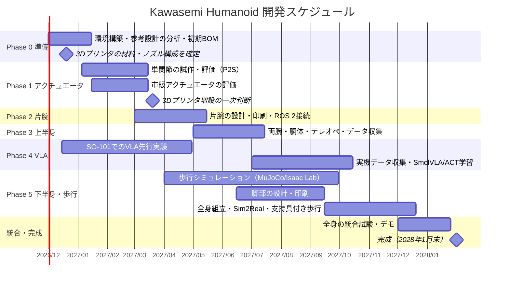

# 開発スケジュール（2028年1月完成）

**作成日：2026年11月24日**
**期間：2026年12月〜2028年1月（約14か月）**

---

# 1. 「完成」の定義

14か月でPhase 0〜7をすべて研究レベルまで仕上げるのは難しい。そこで2028年1月の完成条件を次のように決め、それ以外は延長目標とする。

## 必達（2028年1月末）

1. 全身（上半身＋下半身）のオリジナルヒューマノイドが組み上がっている
2. 上半身が、自然言語指示によるPick and Place（Task 1・2）を成功率70%以上でこなす
3. 二足で立位保持と前進歩行ができる（安全支持具あり、数メートル）
4. ROS 2・安全監視層・データ収集基盤が動いている
5. CAD・3MF・BOM・ソフトウェアがこのリポジトリで再現できる状態になっている

## 延長目標（2028年2月以降）

- 両腕協調・失敗回復（Task 3・4）の高い成功率
- 歩行中の物体操作（Loco-Manipulation、Phase 6）
- 視触覚世界モデル・Agentic AIによる自己改善（Phase 7）

---

# 2. 全体スケジュール

**ポイント：** ハードウェアの完成を待たずに、VLA（SO-101で先行）と歩行RL（シミュレーション）を並行して進める。これが14か月で間に合わせるための前提になる。

---

# 3. マイルストーン

| 時期 | マイルストーン | 合格条件 |
|---|---|---|
| 2026年12月 | 3Dプリンタの構成を確定 | 硬化鋼ノズル・乾燥機・材料を用意（[3Dプリンタ選定ガイド](3d-printer-selection.md)） |
| 2027年1月 | Phase 0完了 | MuJoCo/RViz2でBHLモデルを表示、初期BOM |
| 2027年3月 | **単関節が完成・3Dプリンタ増設の判断** | トルク・バックラッシュ・発熱の評価データ。自作か市販か決める |
| 2027年5月 | 片腕がROS 2で動く | 関節位置制御、カメラ統合 |
| 2027年7月 | 上半身でデータ収集を開始 | テレオペで50エピソード／タスク |
| 2027年9月 | 脚部の部品が揃う。シミュレーションで歩行 | Isaac Labで前進歩行ポリシー |
| 2027年10月 | 上半身VLAのデモ | Task 1・2で成功率70%以上 |
| 2027年12月 | 実機で支持具付き歩行 | 立位保持、前進数メートル |
| 2028年1月 | **完成** | 第1節の必達条件をすべて満たす |

---

# 4. 3Dプリンタの稼働計画

印刷が集中する時期は2回ある。

| 時期 | 印刷対象 | 負荷 |
|---|---|---|
| 2027年1〜3月 | 減速機・単関節の試作（何度も作り直す） | 中 |
| 2027年3〜7月 | 片腕 → 両腕・胴体 | 高 |
| 2027年6〜9月 | 脚部（大型・高負荷部品） | **最大**（上半身の改良と重なる） |
| 2027年10〜12月 | 破損部品の再印刷・改良 | 中 |

2027年6〜9月は上半身の改良と脚部の印刷が重なる。P2S 1台で足りない見込みなら、**2027年4月までに増設機を発注し、5月までに稼働させる**（判断方法は[3Dプリンタ選定ガイド](3d-printer-selection.md)の第4・5節）。

---

# 5. スケジュール上のリスク

| リスク | 影響 | 対策 |
|---|---|---|
| 自作アクチュエータの摩耗・バックラッシュ | Phase 1が長引き、全体が遅れる | 2027年3月の時点で市販アクチュエータに切り替えられるようにしておく |
| 部品の納期（モータ、ドライバ） | 組立が遅れる | 長納期品はPhase 0で発注する |
| 印刷時間の不足 | 脚部の試作回数が減る | 増設機・外注（MJF）を早めに判断する |
| Sim2Realの差 | 実機歩行が年内に間に合わない | 支持具付き歩行を必達とし、自由歩行は延長目標にする |
| VLAデータの不足 | 成功率が上がらない | SO-101で手順を確立しておき、収集を自動化する |

毎月末にこの表とガントチャートを見直し、遅れが2週間を超えたら範囲（延長目標へ回す項目）を調整する。
